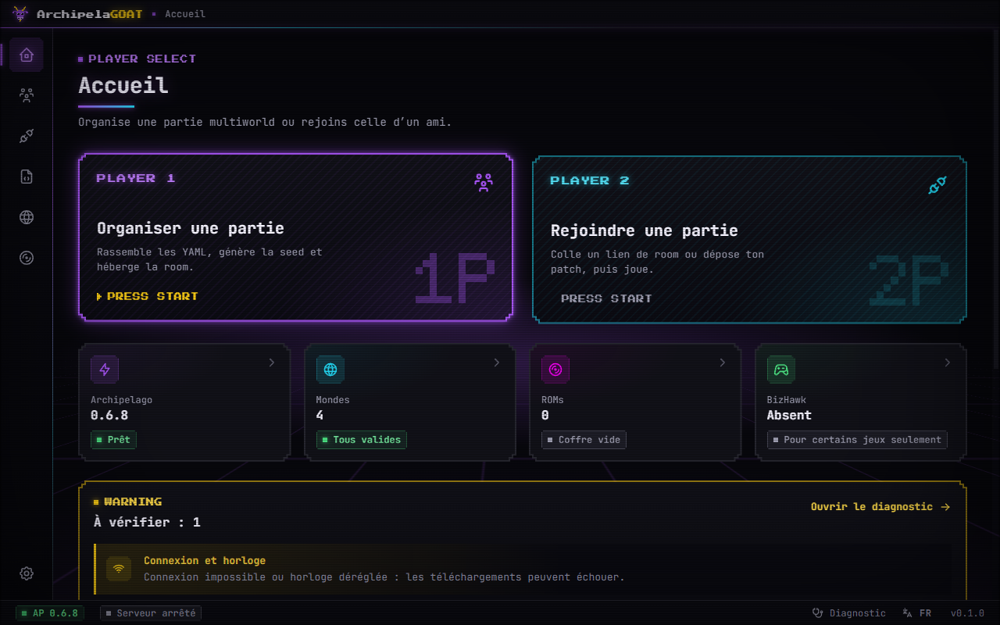
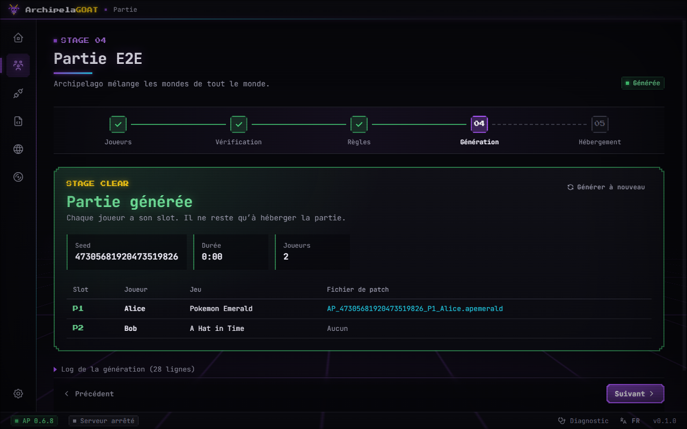
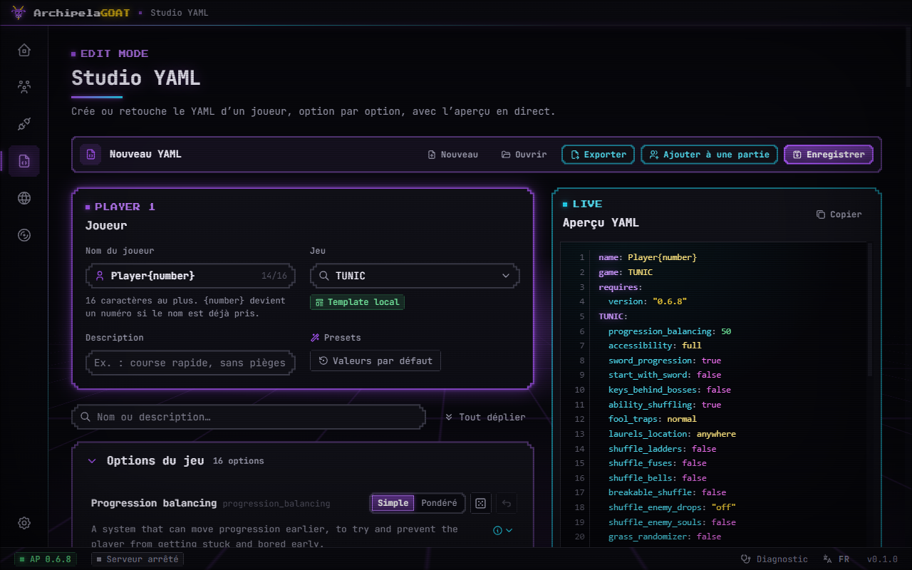
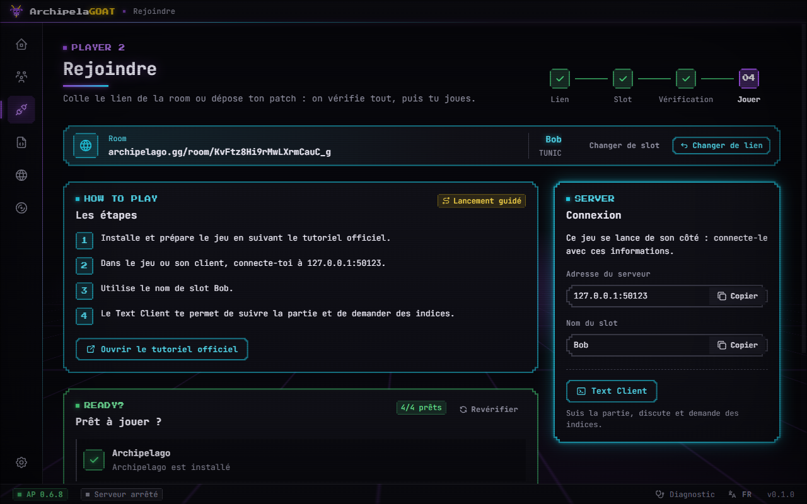
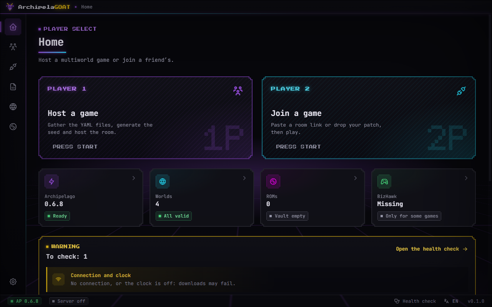
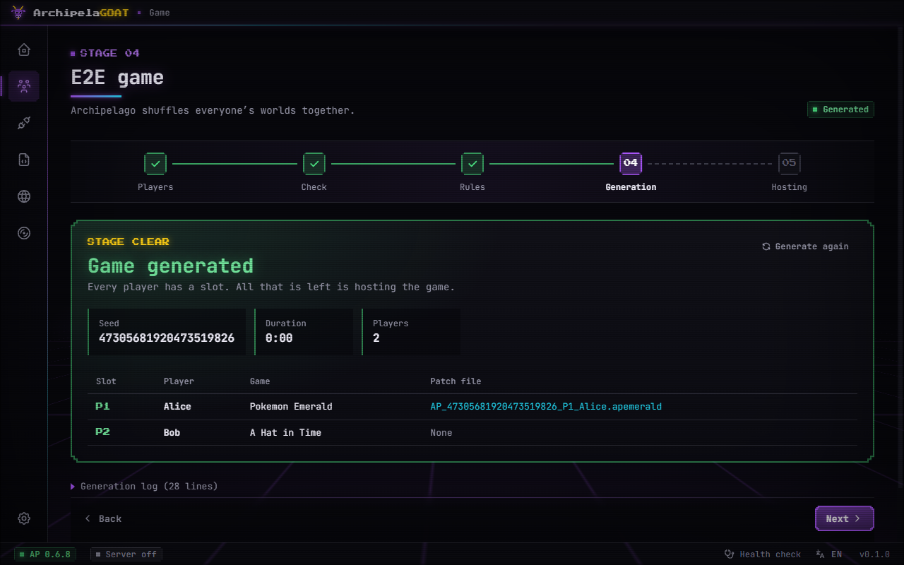
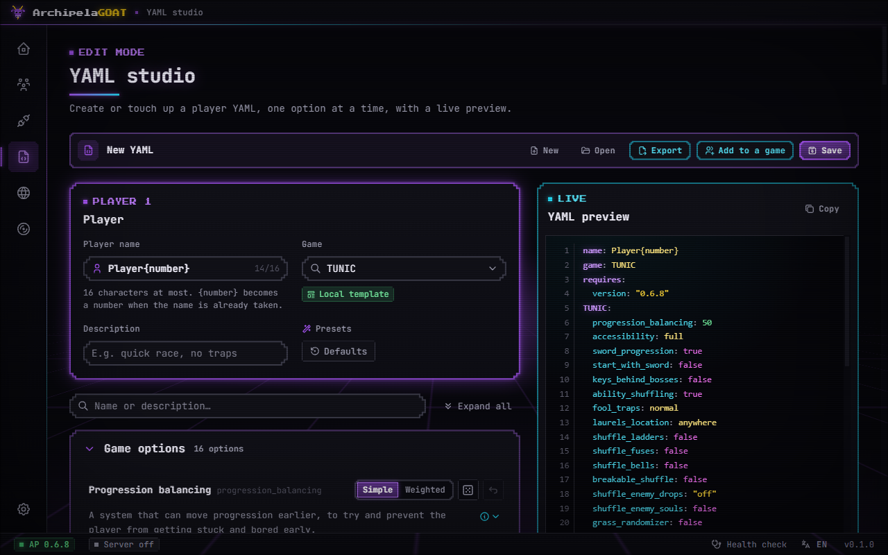
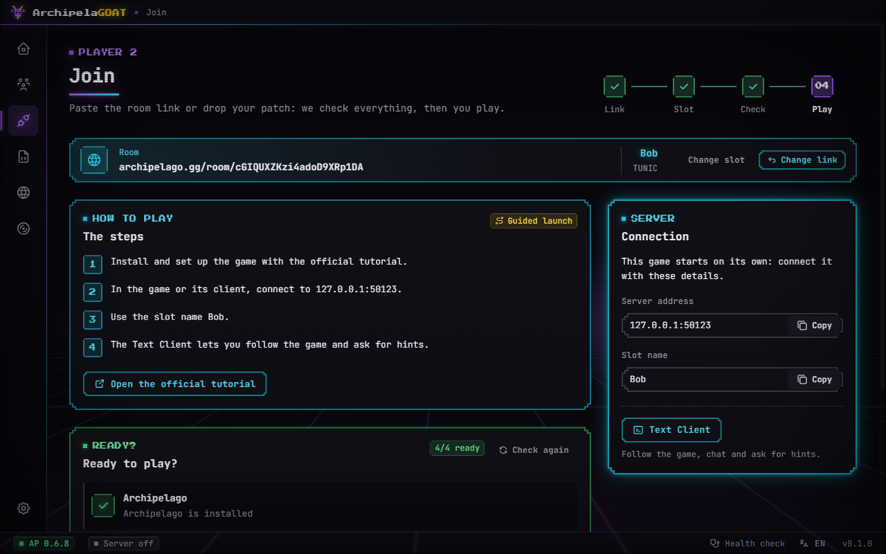

<p align="center">
  
</p>

<h1 align="center">ArchipelaGOAT</h1>

<p align="center">
  <strong>Compagnon non officiel pour Archipelago · Unofficial Archipelago companion</strong><br />
  <a href="#français">Français</a> · <a href="#english">English</a>
</p>

---

## Français

ArchipelaGOAT installe [Archipelago](https://archipelago.gg), le randomizer multiworld, et prépare tes
parties de bout en bout : les YAML des joueurs, la génération, l’hébergement en local ou sur
archipelago.gg, puis le lancement du bon client pour chaque jeu. Une app de bureau pour Windows 10/11 et
Linux, en français et en anglais, sans terminal ni édition de `host.yaml` à la main.

> [!IMPORTANT]
> **ArchipelaGOAT est un compagnon non officiel.** Il n’est ni développé ni soutenu par l’équipe
> d’Archipelago. Il pilote les programmes officiels d’Archipelago, sans les modifier, et les pages
> documentées d’archipelago.gg. Les problèmes de l’app se signalent ici, pas à l’équipe d’Archipelago.

### Fonctionnalités

- **Installation d’Archipelago** 0.6.8 (série 0.6) : l’installateur officiel sous Windows (une seule
  invite UAC), l’archive officielle sous Linux (sans root ni FUSE). Mise à jour et désinstallation.
- **Diagnostic** : APWorlds cassés, port 38281 occupé, programme d’Archipelago resté ouvert, connexion…
  chaque alerte avec son action.
- **Mondes** : les APWorlds installés, et le catalogue de la communauté (index ionium et wiki
  d’Archipelago) avec un écran de confiance et une empreinte sha256 vérifiée avant chaque installation.
  Le catalogue propose aussi les jeux non officiels que seul le wiki d’Archipelago liste, signalés comme
  tels et toujours derrière l’écran de confiance.
- **Studio YAML** : le YAML d’un joueur option par option, en mode simple ou pondéré, avec l’aperçu et la
  validation en direct.
- **Organiser une partie** : joueurs, vérification, règles, génération, hébergement. Ensuite, l’adresse
  et le message à partager, les joueurs connectés, le flux d’objets et la console du serveur.
- **Rejoindre une partie** : un lien de room ou un patch suffit. L’app vérifie ce qu’il faut, puis
  lance le bon client (BizHawk en un clic pour les jeux qui le prennent en charge).
- **Coffre ROM** : tes dumps sont reconnus par leur MD5 et indiqués à Archipelago.

### Captures

| Accueil                                               | Organiser : génération                                      |
| ----------------------------------------------------- | ----------------------------------------------------------- |
|               |  |
| **Studio YAML**                                       | **Rejoindre**                                               |
|  |              |

### Installation

Chaque version fournit cinq fichiers, et `SHA256SUMS.txt` pour les vérifier
(`sha256sum -c SHA256SUMS.txt --ignore-missing` sous Linux, `Get-FileHash <fichier>` sous Windows).

| Système | Fichier                                | Usage                                                                                    |
| ------- | -------------------------------------- | ---------------------------------------------------------------------------------------- |
| Windows | `ArchipelaGOAT-Setup-<version>.exe`    | Installateur pour ton compte, sans droits administrateur ; dossier au choix              |
| Windows | `ArchipelaGOAT-<version>-portable.exe` | Sans installation : lance-le directement                                                 |
| Linux   | `ArchipelaGOAT-<version>.AppImage`     | `chmod +x` puis lance-le (FUSE 2 requis : `libfuse2`, ou `libfuse2t64` sur Ubuntu 24.04) |
| Linux   | `archipelagoat_<version>_amd64.deb`    | `sudo apt install ./archipelagoat_<version>_amd64.deb`                                   |
| Linux   | `ArchipelaGOAT-<version>.tar.gz`       | Extrais l’archive, `cd ArchipelaGOAT-<version>`, puis lance `./archipelagoat.sh`         |

Linux : x64 avec glibc 2.35 ou plus récente (Ubuntu 22.04, Debian 12, Fedora 36…).

#### Linux : le bac à sable de Chromium

L’app garde le bac à sable de Chromium (elle n’est jamais livrée avec `--no-sandbox`). Depuis Ubuntu
23.10, AppArmor empêche un programme sans profil de créer les espaces de noms dont ce bac à sable a besoin :

- **`.deb`** : le paquet installe le profil AppArmor de sa copie. Rien à faire.
- **`tar.gz`** : lance l’app avec `./archipelagoat.sh`. Si elle s’arrête sur son bac à sable
  (`chrome-sandbox`), le script affiche les deux commandes qui donnent une fois pour toutes un profil
  AppArmor à ta copie, avec ses chemins : un fichier dans `/etc/apparmor.d/` (le même profil que celui
  du `.deb`, avec `userns`), puis `sudo apparmor_parser -r` sur ce fichier.
- **AppImage** : son lanceur (celui d’electron-builder) démarre l’app sans le bac à sable quand
  AppArmor bloque ces espaces de noms ; le diagnostic de l’app le signale. Sur Ubuntu 23.10 ou plus
  récent, préfère le `.deb` pour garder le bac à sable.

#### Avertissement SmartScreen (Windows)

L’app n’est pas encore signée. Au premier lancement, Windows affiche **« Windows a protégé votre
ordinateur »**. Pour continuer : clique sur **Informations complémentaires**, vérifie que le fichier est
bien `ArchipelaGOAT-Setup-<version>.exe` (ou le portable), puis clique sur **Exécuter quand même**.
Vérifie d’abord son empreinte dans `SHA256SUMS.txt` si tu l’as reçu d’ailleurs que de la page des
versions.

### Non-affiliation

ArchipelaGOAT est un projet indépendant. « Archipelago » désigne le projet
[ArchipelagoMW/Archipelago](https://github.com/ArchipelagoMW/Archipelago) ; ArchipelaGOAT n’en reprend ni
le logo ni les images d’archipelago.gg, et s’affiche partout comme compagnon non officiel. Merci aux
bénévoles qui maintiennent Archipelago et archipelago.gg : l’app s’identifie auprès du site
(`ArchipelaGOAT/<version> (unofficial Archipelago companion)`) et ne fait rien sans ton accord explicite.

### ROMs

**ArchipelaGOAT ne télécharge, ne fournit et ne lie jamais aucune ROM, ISO ou WAD.** Tu utilises tes
propres dumps, faits à partir de jeux que tu possèdes. L’app les reconnaît par leur empreinte MD5 et
indique leur emplacement à Archipelago ; elle ne les copie nulle part ailleurs et ne les envoie jamais.

### Attributions

- [Archipelago](https://github.com/ArchipelagoMW/Archipelago) (licence MIT), par l’équipe ArchipelagoMW :
  le randomizer multiworld que l’app installe et pilote.
- [Wiki d’Archipelago](https://archipelago.miraheze.org/) (contenu sous licence
  [CC BY-NC-SA 4.0](https://creativecommons.org/licenses/by-nc-sa/4.0/)) : statuts, mainteneurs et
  liens des mondes du catalogue, et les jeux que seul le wiki liste, lus à l’exécution.
- [Index ionium](https://github.com/ionium-ap/Archipelago-index) : la liste communautaire des APWorlds et
  de leurs empreintes, lue à l’exécution, jamais redistribuée.

Les licences des dépendances livrées avec l’app sont listées dans **Réglages → À propos**.

### Développement

Prérequis : Node.js 22.12 ou plus récent, npm.

```sh
npm ci
node node_modules/electron/install.js   # Electron 44 ne télécharge plus son binaire à l’installation
npm run dev                             # l’app en développement
```

| Commande                            | Rôle                                                                            |
| ----------------------------------- | ------------------------------------------------------------------------------- |
| `npm run typecheck`, `npm run lint` | Types et lint                                                                   |
| `npm test`                          | Tests unitaires et du renderer (couverture)                                     |
| `npm run test:integration`          | Parcours complets contre un faux Archipelago et un faux archipelago.gg          |
| `npm run build && npm run test:e2e` | E2E Playwright de l’app construite, en FR et en EN                              |
| `npm run icons`                     | `build/icon.svg` → `build/icon.png`, `build/icons/`, `build/icon.ico`           |
| `npm run dist:win`                  | Installateur NSIS et exe portable dans `release/<version>/`                     |
| `npm run dist:linux:docker`         | AppImage, deb et tar.gz, construits dans Docker (`electronuserland/builder:24`) |
| `npm run checksums`                 | `release/<version>/SHA256SUMS.txt`                                              |

Les captures des E2E vont dans `test-results/screenshots/` ; `GOAT_E2E_UPDATE_SCREENSHOTS=1` met à jour
celles du dépôt (`tests/e2e/screenshots/`). Après les builds, les smoke tests des paquets :
`GOAT_E2E_PACKAGED=1 npx playwright test tests/e2e/packaged-win.spec.ts` sous Windows (installe puis
désinstalle l’installateur NSIS dans un dossier temporaire) et `node scripts/smoke-linux-docker.mjs`.

La CI (`.github/workflows/ci.yml`) lance ces vérifications sous Ubuntu et Windows. Sur un tag `v*`,
`.github/workflows/release.yml` construit les paquets et les publie dans une release GitHub en brouillon.

---

## English

ArchipelaGOAT installs [Archipelago](https://archipelago.gg), the multiworld randomizer, and sets up your
games end to end: the players’ YAML files, generation, hosting on your machine or on archipelago.gg, then
the right client for each game. A desktop app for Windows 10/11 and Linux, in English and French, with no
terminal and no hand-editing of `host.yaml`.

> [!IMPORTANT]
> **ArchipelaGOAT is an unofficial companion.** It is not made or endorsed by the Archipelago team. It
> drives Archipelago’s official programs, unmodified, and the documented pages of archipelago.gg. Report
> problems with the app here, not to the Archipelago team.

### Features

- **Archipelago install** of 0.6.8 (0.6 series): the official installer on Windows (a single UAC prompt),
  the official archive on Linux (no root, no FUSE). Updates and uninstall.
- **Doctor**: broken APWorlds, port 38281 in use, an Archipelago program left open, connectivity…
  each warning with its fix.
- **Worlds**: your installed APWorlds, and the community catalog (the ionium index and the Archipelago
  wiki) with a trust screen and a verified sha256 before every install. The catalog also offers the
  unofficial games only the Archipelago wiki lists, flagged as such and always behind the trust screen.
- **YAML studio**: a player’s YAML option by option, in simple or weighted mode, with a live preview and
  live validation.
- **Organize a game**: players, check, rules, generation, hosting. Then the address and a message to
  share, who is connected, the item feed and the server console.
- **Join a game**: a room link or a patch is enough. The app checks what is needed, then starts the right
  client (BizHawk in one click for the games that use it).
- **ROM vault**: your dumps are recognized by their MD5 and pointed out to Archipelago.

### Screenshots

| Home                                                  | Organize: generation                                        |
| ----------------------------------------------------- | ----------------------------------------------------------- |
|                  |  |
| **YAML studio**                                       | **Join**                                                    |
|  |                   |

### Install

Each version comes as five files, with `SHA256SUMS.txt` to check them
(`sha256sum -c SHA256SUMS.txt --ignore-missing` on Linux, `Get-FileHash <file>` on Windows).

| System  | File                                   | Use                                                                                  |
| ------- | -------------------------------------- | ------------------------------------------------------------------------------------ |
| Windows | `ArchipelaGOAT-Setup-<version>.exe`    | Installer for your account, no admin rights; folder of your choice                   |
| Windows | `ArchipelaGOAT-<version>-portable.exe` | No install: run it as is                                                             |
| Linux   | `ArchipelaGOAT-<version>.AppImage`     | `chmod +x`, then run it (needs FUSE 2: `libfuse2`, or `libfuse2t64` on Ubuntu 24.04) |
| Linux   | `archipelagoat_<version>_amd64.deb`    | `sudo apt install ./archipelagoat_<version>_amd64.deb`                               |
| Linux   | `ArchipelaGOAT-<version>.tar.gz`       | Extract it, `cd ArchipelaGOAT-<version>`, then run `./archipelagoat.sh`              |

Linux: x64 with glibc 2.35 or later (Ubuntu 22.04, Debian 12, Fedora 36…).

#### Linux: Chromium’s sandbox

The app keeps Chromium’s sandbox on (it never ships with `--no-sandbox`). Since Ubuntu 23.10, AppArmor
keeps a program without a profile from creating the user namespaces that sandbox needs:

- **`.deb`**: the package installs the AppArmor profile of its copy. Nothing to do.
- **`tar.gz`**: start the app with `./archipelagoat.sh`. If it stops on its sandbox (`chrome-sandbox`),
  the script prints the two commands that give your copy an AppArmor profile once and for all, with its
  paths: a file in `/etc/apparmor.d/` (the same profile as the `.deb` one, with `userns`), then
  `sudo apparmor_parser -r` on that file.
- **AppImage**: its launcher (electron-builder’s) starts the app without the sandbox when AppArmor
  blocks those namespaces; the app’s health check says so. On Ubuntu 23.10 or later, prefer the `.deb`
  to keep the sandbox.

#### SmartScreen warning (Windows)

The app is not signed yet. On first launch, Windows shows **“Windows protected your PC”**. To go on:
click **More info**, check that the file is `ArchipelaGOAT-Setup-<version>.exe` (or the portable one),
then click **Run anyway**. If you got the file from anywhere but the releases page, check its hash
against `SHA256SUMS.txt` first.

### Not affiliated

ArchipelaGOAT is an independent project. “Archipelago” is the
[ArchipelagoMW/Archipelago](https://github.com/ArchipelagoMW/Archipelago) project; ArchipelaGOAT uses
neither its logo nor archipelago.gg’s images, and shows itself everywhere as an unofficial companion.
Thanks to the volunteers who run Archipelago and archipelago.gg: the app identifies itself to the site
(`ArchipelaGOAT/<version> (unofficial Archipelago companion)`) and does nothing there without your
explicit consent.

### ROMs

**ArchipelaGOAT never downloads, provides or links any ROM, ISO or WAD.** You use your own dumps, made
from games you own. The app recognizes them by their MD5 hash and tells Archipelago where they are; it
never copies them anywhere else and never sends them.

### Credits

- [Archipelago](https://github.com/ArchipelagoMW/Archipelago) (MIT license), by the ArchipelagoMW team:
  the multiworld randomizer the app installs and drives.
- [Archipelago wiki](https://archipelago.miraheze.org/) (content under
  [CC BY-NC-SA 4.0](https://creativecommons.org/licenses/by-nc-sa/4.0/)): status, maintainers and links
  of the catalog’s worlds, and the games only the wiki lists, read at runtime.
- [ionium index](https://github.com/ionium-ap/Archipelago-index): the community list of APWorlds and
  their hashes, read at runtime, never redistributed.

The licenses of the dependencies shipped with the app are listed in **Settings → About**.

### Development

Requirements: Node.js 22.12 or later, npm.

```sh
npm ci
node node_modules/electron/install.js   # Electron 44 no longer downloads its binary at install time
npm run dev                             # the app in development
```

| Command                             | What it does                                                              |
| ----------------------------------- | ------------------------------------------------------------------------- |
| `npm run typecheck`, `npm run lint` | Types and lint                                                            |
| `npm test`                          | Unit and renderer tests (coverage)                                        |
| `npm run test:integration`          | Full flows against a fake Archipelago and a fake archipelago.gg           |
| `npm run build && npm run test:e2e` | Playwright E2E of the built app, in English and French                    |
| `npm run icons`                     | `build/icon.svg` → `build/icon.png`, `build/icons/`, `build/icon.ico`     |
| `npm run dist:win`                  | NSIS installer and portable exe in `release/<version>/`                   |
| `npm run dist:linux:docker`         | AppImage, deb and tar.gz, built in Docker (`electronuserland/builder:24`) |
| `npm run checksums`                 | `release/<version>/SHA256SUMS.txt`                                        |

E2E screenshots go to `test-results/screenshots/`; `GOAT_E2E_UPDATE_SCREENSHOTS=1` updates the committed
ones (`tests/e2e/screenshots/`). After the builds, the package smoke tests:
`GOAT_E2E_PACKAGED=1 npx playwright test tests/e2e/packaged-win.spec.ts` on Windows (it installs, then
uninstalls, the NSIS installer in a temporary folder) and `node scripts/smoke-linux-docker.mjs`.

CI (`.github/workflows/ci.yml`) runs these checks on Ubuntu and Windows. On a `v*` tag,
`.github/workflows/release.yml` builds the packages and publishes them to a draft GitHub release.
